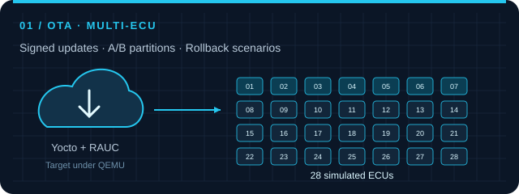
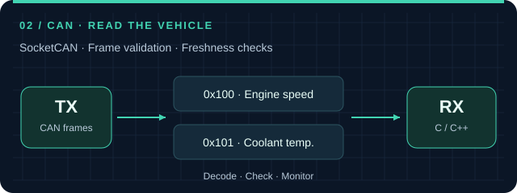
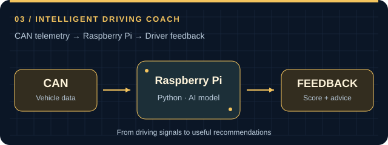
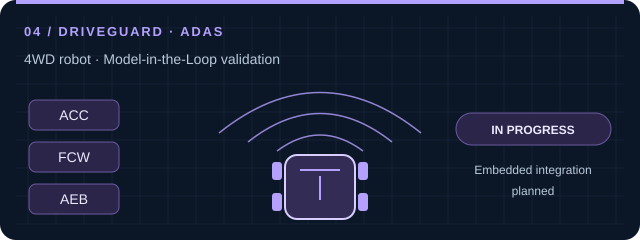

  

<h1 align="center">Younes AROUK</h1>
<h3 align="center">MODEL. BUILD. VALIDATE.</h3>

Automotive mechatronics · Embedded systems · Systems engineering

  
  
  

## 01 / Engineering snapshot

**I connect mechanics, electronics and software through automotive projects.** My interests: how systems communicate, update and behave when something goes wrong.

<table>
  <tr>
    <td width="50%" valign="top">
      <h3>🎓 My background</h3>
      
Final-year <strong>Automotive &amp; Digital Solutions engineering student</strong> at ENSA Berrechid, Morocco.

      
Work-study <strong>Design Release Engineer (DRE) / Component Owner</strong> at SEGULA Technologies.

      

    </td>
    <td width="50%" valign="top">
      <h3>🎯 My next step</h3>
      
A <strong>final-year internship</strong> in automotive mechatronics or embedded systems, contributing to design, integration and validation.

      
Current project focus: <strong>DriveGuard</strong>, an ADAS demonstrator on a 4WD robot.

      

    </td>
  </tr>
</table>

## 02 /  Technical stack

### Programming

  
  
  
  

### Embedded targets & communication

  
  
  
  
  

Interfaces: **CAN, SPI, UART/USART and I2C**.

### Embedded Linux & OTA

  
  
  
  

BitBake · signed updates · A/B partitions · rollback.

### Modelling & systems engineering

  
  
  
  

Functional analysis · requirements · Cameo Systems Modeler · V-model · Proteus.

### Development & validation

  
  

Model-in-the-Loop (MIL) · fault injection · health checks · logs · FastAPI dashboards.

### Foundational knowledge

  
  
  
  

STM32 HAL · GPIO · PWM · timers · interrupts · RTOS fundamentals.

## 03 / 🧪 Inside the lab

<table>
  <tr>
    <td width="50%" valign="top">
      
      <h3>Secure OTA &amp; Multi-ECU Simulation</h3>
      
<strong>28 simulated ECUs</strong> and a Yocto/RAUC target under QEMU: update sequencing, signed updates, fault scenarios, rollback and a monitoring dashboard.

      

  
  
  
  

      
<a href="https://github.com/YounesArouk/pfa-ota-multi-ecu">Explore the OTA project →</a>

    </td>
    <td width="50%" valign="top">
      
      <h3>CAN Communication</h3>
      
A Linux SocketCAN receiver that decodes engine speed and coolant temperature, validates frames and detects stale measurements.

      

  
  
  
  

      
<a href="https://github.com/YounesArouk/Gestion_CAN">Explore the CAN project →</a>

    </td>
  </tr>
  <tr>
    <td width="50%" valign="top">
      
      <h3>Intelligent Driving Coach</h3>
      
CAN data analysed on a Raspberry Pi by a model that produces a driving score and recommendations.

      

  
  
  
  

      
<a href="https://github.com/YounesArouk/coach-conduite-intelligent">Explore the driving coach →</a>

    </td>
    <td width="50%" valign="top">
      
      <h3>DriveGuard · 4WD Robot</h3>
      
ACC, FCW and AEB modelled and validated in MATLAB/Simulink (MIL). C/C++ integration on STM32 and Raspberry Pi, CAN communication and Qt supervision are <strong>planned</strong>.

      

  
  
  

      
<em>Work in progress · From the model towards embedded integration.</em>

    </td>
  </tr>
</table>

## 04 / Learning checkpoints

- **Modeling and Simulation with Simulink** — MathWorks / Coursera, May 2026.
- **Automobile Engineering: How Modern Cars Are Built** — Starweaver.

---

<h3 align="center">Let's work on the next system.</h3>

Interested in automotive mechatronics or embedded systems? Let's connect.

  
  
  

<a href="mailto:aroukyounes2@gmail.com">aroukyounes2@gmail.com</a>

