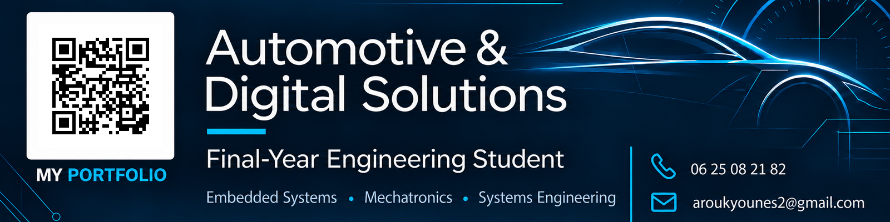

  

<h1 align="center">Younes AROUK</h1>

<strong>MODEL. BUILD. VALIDATE.</strong>

  An engineering notebook for automotive mechatronics and embedded systems. 
  From a vehicle signal to a validated function.

  <a href="https://portfolio-younes-arouk.vercel.app/">Explore my portfolio</a>
  &nbsp; · &nbsp;
  <a href="https://younesarouk.github.io/CV-html/">CV · FR / EN</a>
  &nbsp; · &nbsp;
  <a href="mailto:aroukyounes2@gmail.com">Get in touch</a>

---

I am a final-year **Automotive & Digital Solutions engineering student at ENSA Berrechid, Morocco**, and a work-study **Design Release Engineer (DRE) / Component Owner at SEGULA Technologies**. My projects bring together mechanics, electronics and software, with an interest in how automotive systems communicate, update and behave when something goes wrong.

## 01 / Inside the lab

<table>
  <tr>
    <td width="50%" valign="top">
      
01 · EMBEDDED LINUX / OTA

      <h3>Keep the system up to date</h3>
      
<strong>Secure OTA &amp; Multi-ECU Simulation</strong>

      
A simulation of <strong>28 ECUs</strong> combined with a Yocto/RAUC target under QEMU. Update sequencing, signed updates, fault scenarios, rollback and a monitoring dashboard.

      
<code>Python</code> <code>Yocto</code> <code>RAUC</code> <code>QEMU</code> <code>FastAPI</code>

      
<a href="https://github.com/YounesArouk/pfa-ota-multi-ecu">Explore the OTA project →</a>

    </td>
    <td width="50%" valign="top">
      
02 · VEHICLE COMMUNICATION

      <h3>Read the vehicle</h3>
      
<strong>CAN Communication</strong>

      
A Linux SocketCAN receiver that decodes engine speed and coolant temperature, validates frames and detects stale measurements.

      
<code>C11</code> <code>C++17</code> <code>SocketCAN</code> <code>Linux</code>

      
<a href="https://github.com/YounesArouk/Gestion_CAN">Explore the CAN project →</a>

    </td>
  </tr>
  <tr>
    <td width="50%" valign="top">
      
03 · DATA / DRIVER FEEDBACK

      <h3>Turn data into feedback</h3>
      
<strong>Intelligent Driving Coach</strong>

      
Driving data travels over CAN to a Raspberry Pi, where a model analyses driving behaviour and produces a score and recommendations.

      
<code>Python</code> <code>Raspberry Pi</code> <code>Arduino</code> <code>MCP2515</code> <code>CAN</code>

      
<a href="https://github.com/YounesArouk/coach-conduite-intelligent">Explore the driving coach →</a>

    </td>
    <td width="50%" valign="top">
      
04 · ADAS / WORK IN PROGRESS

      <h3>Build a safer drive</h3>
      
<strong>DriveGuard · 4WD Robot</strong>

      
ACC, FCW and AEB functions modelled and validated in MATLAB/Simulink (MIL). C/C++ integration on STM32 and Raspberry Pi, CAN communication and Qt supervision are planned.

      
<code>MATLAB</code> <code>Simulink</code> <code>MIL</code> <code>ADAS</code>

      
<em>Current focus: moving from the model towards embedded integration.</em>

    </td>
  </tr>
</table>

## 02 / My toolkit, by purpose

| Engineering step | Methods and tools |
| :--- | :--- |
| **MODEL & SPECIFY** | MATLAB/Simulink, functional analysis, requirements, SysML, Cameo Systems Modeler, V-model; CATIA V5, KiCad and Proteus. |
| **BUILD & INTEGRATE** | C, C++, Python, Shell; STM32, ESP32, Raspberry Pi, Arduino; CAN, SPI, UART/USART, I2C; Linux, Yocto/Poky, BitBake, RAUC, Git and STM32CubeIDE. |
| **TEST & VALIDATE** | Model-in-the-Loop (MIL), QEMU, fault injection, health checks, logs, A/B partitions and rollback scenarios. |

**Foundational knowledge:** STM32 HAL, GPIO, PWM, timers and interrupts; RTOS/FreeRTOS; AUTOSAR, ASPICE and ISO 26262.

## 03 / Learning checkpoints

- **Modeling and Simulation with Simulink** — MathWorks / Coursera, May 2026.
- **Automobile Engineering: How Modern Cars Are Built** — Starweaver.

---

### Let's work on the next system

I am looking for a **final-year internship in automotive mechatronics or embedded systems**, with opportunities to contribute to design, integration and validation.

**Contact:** [aroukyounes2@gmail.com](mailto:aroukyounes2@gmail.com)  
**Explore:** [Portfolio](https://portfolio-younes-arouk.vercel.app/) · [CV in French & English](https://younesarouk.github.io/CV-html/)
